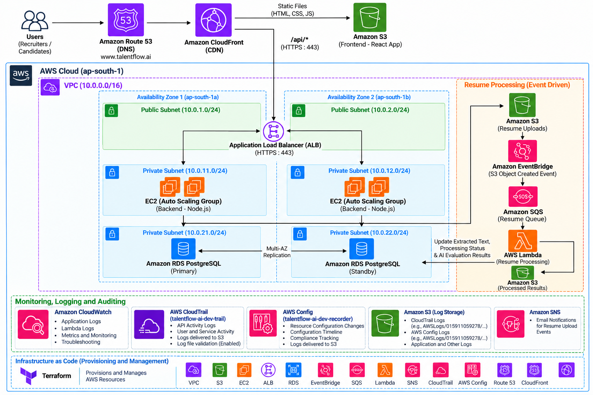

# TalentFlow AI — AI-Assisted Recruitment Management Platform

An AI-assisted recruitment management platform developed as part of an internship project at **Davine Technologies**. The project combines backend application development, AWS cloud infrastructure, Infrastructure as Code (IaC), event-driven resume processing, AI-assisted candidate evaluation, and cloud monitoring.


---
#Architecture 



---


## Table of Contents

- [Project Overview](#project-overview)
- [Project Objectives](#project-objectives)
- [Key Features](#key-features)
- [Technology Stack](#technology-stack)
- [System Architecture](#system-architecture)
- [End-to-End Workflow](#end-to-end-workflow)
- [AWS Infrastructure](#aws-infrastructure)
- [Resume Processing Pipeline](#resume-processing-pipeline)
- [AI-Assisted Candidate Evaluation](#ai-assisted-candidate-evaluation)
- [Terraform Infrastructure Management](#terraform-infrastructure-management)
- [Monitoring and Auditing](#monitoring-and-auditing)
- [Project Structure](#project-structure)
- [Prerequisites](#prerequisites)
- [Local Development Setup](#local-development-setup)
- [AWS Deployment Workflow](#aws-deployment-workflow)
- [Testing and Validation](#testing-and-validation)
- [Challenges and Solutions](#challenges-and-solutions)
- [Security Considerations](#security-considerations)
- [Limitations](#limitations)
- [Future Enhancements](#future-enhancements)
- [Learning Outcomes](#learning-outcomes)
- [References](#references)

---

## Project Overview

TalentFlow AI is a recruitment management platform designed to organize candidate information, job records, applications, and AI-assisted resume evaluation in one application.

The project uses a Node.js and Express.js backend with PostgreSQL for structured data storage. AWS services provide application hosting, resume storage, asynchronous processing, notifications, and operational visibility.

Resume processing is automated through Amazon S3, Amazon EventBridge, Amazon SQS, and AWS Lambda. The Lambda function extracts text from supported PDF resumes and updates the corresponding candidate record in PostgreSQL.

The application also integrates the Groq API using the model `openai/gpt-oss-20b` for AI-assisted candidate evaluation. Evaluation results, including candidate scores and skill-related findings, are stored for recruiter review.

The supporting infrastructure is managed through modular Terraform configurations, with Amazon S3 for Terraform remote state storage and Amazon DynamoDB for state locking.

### Project Information

| Item | Details |
|---|---|
| Project | TalentFlow AI |
| Organization | Davine Technologies |
| Project Type | Internship Project |
| Domain | Cloud Computing, AWS, DevOps, and AI-Assisted Recruitment |
| Backend | Node.js, Express.js |
| Database | PostgreSQL / Amazon RDS |
| Infrastructure as Code | Terraform |
| AI Provider | Groq API |
| AI Model | `openai/gpt-oss-20b` |

## Project Objectives

- Develop a centralized recruitment management application.
- Provision AWS infrastructure using modular Terraform configurations.
- Store uploaded resumes in Amazon S3.
- Automate PDF resume text extraction using AWS Lambda.
- Connect S3 events to asynchronous processing through EventBridge and SQS.
- Integrate AI-assisted candidate evaluation using the Groq API.
- Store candidate information, extracted resume text, processing status, and evaluation results in PostgreSQL.
- Configure notifications for relevant resume-upload events.
- Use CloudWatch, CloudTrail, and AWS Config to improve operational visibility and auditing.

## Key Features

### 1. Candidate and Recruitment Management
Manage candidate information and associated recruitment records through the application.

### 2. Resume Upload and Storage
Store uploaded resume files in Amazon S3, separating document storage from structured database records.

### 3. Automated Resume Processing
Use an event-driven workflow to process supported PDF resumes, extract text, and update candidate records.

### 4. AI-Assisted Candidate Evaluation
Generate candidate evaluation scores and skill-related findings using the configured Groq AI model.

### 5. Processing Status Tracking
Store processing states, extracted text, and processing timestamps in PostgreSQL.

### 6. Email Notifications
Use Amazon SNS to send email notifications when configured resume-upload events occur.

### 7. Infrastructure as Code
Use reusable Terraform configurations to define and manage AWS resources.

### 8. Remote Terraform State
Store Terraform state in Amazon S3 and use Amazon DynamoDB for state locking.

### 9. Monitoring and Auditing
Use CloudWatch for operational monitoring, CloudTrail for AWS activity logs, and AWS Config for resource configuration tracking.

---

## Technology Stack

| Category | Technologies |
|---|---|
| Backend Development | Node.js, Express.js |
| Programming Languages | JavaScript, Python |
| Database | PostgreSQL, Amazon RDS |
| Compute | Amazon EC2, AWS Lambda |
| Networking | Amazon VPC, Security Groups |
| Traffic Routing | Application Load Balancer |
| Object Storage | Amazon S3 |
| Event Routing | Amazon EventBridge |
| Message Queue | Amazon SQS |
| Notifications | Amazon SNS |
| AI Integration | Groq API |
| AI Model | `openai/gpt-oss-20b` |
| Infrastructure as Code | Terraform |
| Remote State | Amazon S3 |
| State Locking | Amazon DynamoDB |
| Monitoring | Amazon CloudWatch |
| Auditing | AWS CloudTrail |
| Configuration Tracking | AWS Config |
| Version Control | Git, GitHub |
| PDF Processing | Python, `pypdf` |
| Database Connectivity for Lambda | `psycopg2-binary` |

## System Architecture

The platform combines a recruitment application with an asynchronous resume-processing pipeline and AWS operational services.

### Architecture Overview

```text
                     Recruiters / Users
                            |
                            v
                    TalentFlow AI UI
                            |
                            v
                Application Load Balancer
                            |
                            v
                     Amazon EC2
                   Node.js / Express
                            |
                            v
                    Amazon RDS
                     PostgreSQL
                            ^
                            |
                Extracted Text and Status
                            |
                            |
Resume Upload              |
     |                      |
     v                      |
 Amazon S3                  |
     |                      |
     v                      |
 Amazon EventBridge         |
     |                      |
     v                      |
 Amazon SQS                 |
     |                      |
     v                      |
 AWS Lambda ----------------+
 Python / pypdf
     |
     v
 Extract PDF Text

AI-Assisted Evaluation:
TalentFlow AI Backend
          |
          v
       Groq API
          |
          v
 openai/gpt-oss-20b
          |
          v
 Evaluation Results
          |
          v
     PostgreSQL

Notifications:
Amazon EventBridge --> Amazon SNS --> Email

Infrastructure and Operations:
Terraform --> AWS Resources
Amazon S3 --> Terraform Remote State
Amazon DynamoDB --> State Locking
CloudWatch --> Monitoring and Logs
CloudTrail --> AWS Activity Auditing
AWS Config --> Resource Configuration Tracking
```

*Note: This is a logical overview of the project. Actual network paths, frontend hosting, CloudFront integration, IAM permissions, and service triggers depend on the deployed configuration.*

### Main Architecture Components

**Application Layer**
- Node.js and Express.js provide backend APIs and recruitment functionality.
- Amazon EC2 hosts the backend application.
- An Application Load Balancer routes incoming application traffic to configured targets.

**Database Layer**
- Amazon RDS hosts PostgreSQL.
- The database stores recruitment records, resume-processing information, extracted text, and AI evaluation results.

**Resume Storage Layer**
- Amazon S3 stores uploaded resume files.
- S3 events initiate the configured resume-processing workflow.

**Event-Driven Processing Layer**
- Amazon EventBridge routes matching upload events.
- Amazon SQS buffers processing messages.
- AWS Lambda extracts PDF text and updates the corresponding candidate record.

**AI Evaluation Layer**
- The backend integrates with the Groq API.
- The configured model generates candidate evaluation information for recruiter review.

**Operations Layer**
- CloudWatch provides logs, metrics, dashboards, and alarms where configured.
- CloudTrail records AWS account activity.
- AWS Config records resource configuration information.

---

## End-to-End Workflow

1. **Infrastructure provisioning:** Terraform provisions the required AWS resources.
2. **Application deployment:** The Node.js and Express.js backend runs on Amazon EC2.
3. **Database connection:** The application connects to PostgreSQL hosted on Amazon RDS.
4. **Candidate management:** Users manage recruitment records through the application.
5. **Resume upload:** A resume file is uploaded to Amazon S3.
6. **Event detection:** Amazon EventBridge matches the configured upload event.
7. **Message queuing:** Amazon SQS holds the message for asynchronous processing.
8. **Resume processing:** AWS Lambda consumes the message and processes the supported PDF.
9. **Text extraction:** Python and `pypdf` extract the available PDF text.
10. **Database update:** Lambda updates the relevant candidate record with extracted text, processing status, and timestamp.
11. **AI evaluation:** The application uses the Groq API and `openai/gpt-oss-20b` to generate candidate evaluation information.
12. **Result persistence:** Evaluation scores and skill-related findings are stored in PostgreSQL.
13. **Notifications:** Amazon SNS sends email notifications for matching configured upload events.
14. **Monitoring and auditing:** CloudWatch, CloudTrail, and AWS Config support troubleshooting and operational review.

**Important:** The SNS notification is associated with a configured resume-upload event. Receiving that email does not, by itself, prove that Lambda completed resume processing successfully.

---

## AWS Infrastructure

The infrastructure uses AWS services to support application hosting, database connectivity, document processing, and operational visibility.

| AWS Service | Purpose |
|---|---|
| Amazon VPC | Provides network isolation and connectivity. |
| Amazon EC2 | Hosts the backend application. |
| Application Load Balancer | Routes incoming application traffic. |
| Amazon RDS | Provides managed PostgreSQL database hosting. |
| Amazon S3 | Stores resumes, Terraform state, and configured audit records. |
| Amazon EventBridge | Routes matching upload events. |
| Amazon SQS | Buffers asynchronous processing messages. |
| AWS Lambda | Extracts text from supported PDF resumes. |
| Amazon SNS | Sends configured upload-event email notifications. |
| AWS IAM | Controls identities, roles, and service permissions. |
| Amazon CloudWatch | Supports monitoring, logs, and troubleshooting. |
| AWS CloudTrail | Records AWS account activity. |
| AWS Config | Tracks resource configuration information. |
| Amazon DynamoDB | Provides Terraform state locking for the configured backend. |

## Resume Processing Pipeline

The resume-processing pipeline reduces the need for manual extraction and entry of resume text.

### Processing Sequence

```text
Resume Uploaded
      |
      v
Amazon S3
      |
      v
Amazon EventBridge
      |
      v
Amazon SQS
      |
      v
AWS Lambda
      |
      v
Download Supported PDF
      |
      v
Extract Text with pypdf
      |
      v
Connect to PostgreSQL
      |
      v
Update Candidate Record
      |
      v
Store Extracted Text,
Processing Status and Timestamp
```

### Lambda Implementation

The processing function uses:

- **Python 3.12** as the runtime.
- **pypdf** for extracting text from supported PDF documents.
- **psycopg2-binary** for PostgreSQL connectivity.

The processing status tracks values such as `pending`, `processing`, `completed`, and `failed`.

### Validation Evidence

During testing, the project processed a one-page test PDF and extracted approximately **4,160 characters**. The corresponding candidate record reached `completed`, and the execution logs recorded the candidate ID, page count, and extracted character count.

The result demonstrates successful processing of the tested PDF, not universal support for all resume formats.

---

## AI-Assisted Candidate Evaluation

TalentFlow AI integrates the Groq API to generate evaluation information that assists recruiters in reviewing candidates.

### AI Configuration

| Setting | Value |
|---|---|
| Provider | Groq |
| API Integration | Groq API |
| Model Identifier | `openai/gpt-oss-20b` |
| Purpose | AI-assisted candidate evaluation |
| Output | Evaluation score and skill-related findings |

### Evaluation Workflow

1. The application obtains the candidate information available for evaluation.
2. The backend sends the configured evaluation request to the Groq API.
3. The configured model generates evaluation information.
4. The application stores the resulting scores and skill-related findings in PostgreSQL.
5. Recruiters review the results through the application.

During validation, evaluation records with observed scores of **92.00** and **90.00** were present in the database.

These values are test observations, not a measure of model accuracy or proof that a candidate is suitable for a role.

**Responsible AI use:** Evaluation scores are advisory. Recruiters must verify supporting evidence and make hiring decisions through appropriate human review. Resume information should be handled with suitable access controls and privacy safeguards.

---

## Terraform Infrastructure Management

Terraform is used to define and provision AWS resources through modular infrastructure configuration.

### Infrastructure Management Approach

- Organize AWS resources into reusable Terraform modules.
- Maintain infrastructure configuration as code.
- Store remote Terraform state in Amazon S3.
- Use Amazon DynamoDB for state locking.
- Configure IAM permissions for required AWS operations.
- Review Terraform plans before applying infrastructure changes.

### Remote State Architecture

```text
Terraform Configuration
          |
          v
Terraform Backend
          |
          +------------------+
          |                  |
          v                  v
      Amazon S3         Amazon DynamoDB
    Remote State          State Locking
```

Amazon S3 stores the Terraform state file. DynamoDB is used for state locking in the project's configured backend.

Before applying infrastructure changes, review the execution plan and verify the target AWS account, region, resources, and expected cost.

> **Cost warning:** AWS resources such as EC2, RDS, NAT Gateways, load balancers, and data transfer can incur charges. Review running resources and billing before and after testing.

---

## Monitoring and Auditing

### Amazon CloudWatch
Used for operational logs, metrics, dashboards, and alarms where configured. Lambda execution logs can help verify resume-processing behavior and investigate errors.

### AWS CloudTrail
Records AWS account activity and supports auditing API operations. The project's configured trail delivers logs to Amazon S3.

### AWS Config
Records resource configuration information and supports reviewing configuration changes over time. Configuration records are stored according to the configured delivery settings.

### Troubleshooting Approach

When a workflow fails, investigate each stage separately:

1. Confirm the resume exists in the expected S3 bucket.
2. Check the matching EventBridge rule and event delivery.
3. Inspect SQS queue metrics and messages.
4. Review Lambda logs and execution errors in CloudWatch.
5. Verify Lambda IAM permissions and database connectivity.
6. Confirm the candidate record and processing status in PostgreSQL.
7. Review CloudTrail or AWS Config records when investigating infrastructure or configuration issues.

---

## Project Structure

The exact directory structure depends on the checked-out repository. The following is a logical organization of the project's components, not a claim that every directory has this exact name.

```text
talentflow-ai-project/
├── backend/                  # Node.js and Express.js application
│   ├── routes/               # API routes, if organized separately
│   ├── controllers/          # Request handlers, if organized separately
│   ├── db/                   # Database integration, if organized separately
│   ├── package.json          # Backend dependencies and scripts
│   └── .env.example          # Example configuration (recommended)
│
├── frontend/                 # Application interface, if included in this repo
│
├── lambda/                   # Resume-processing function, if included
│   ├── lambda_function.py    # Example handler filename
│   └── requirements.txt      # Python dependencies
│
├── terraform/                # Infrastructure as Code, if included
│   ├── main.tf
│   ├── variables.tf
│   ├── outputs.tf
│   └── modules/
│
├── docs/                     # Architecture diagrams and documentation
│
└── README.md
```

Update this section to match the actual repository folders and filenames before publishing.

---

## Prerequisites

Install or configure the tools required for the component you intend to run:

- Node.js and npm.
- Python 3.12 for the resume-processing Lambda development environment.
- PostgreSQL client tools for database validation.
- Git.
- AWS CLI.
- Terraform.
- An AWS account with appropriately scoped IAM permissions.
- A Groq API key for AI-assisted evaluation.
- Access to the configured PostgreSQL database.

AWS deployment additionally requires the relevant network, compute, database, storage, IAM, event-routing, queue, Lambda, notification, monitoring, and auditing configuration.

## Local Development Setup

The commands below are a general starting point. Adjust paths, npm scripts, environment variable names, and configuration files to match the actual repository.

### 1. Clone the Repository

```bash
git clone https://github.com/sunilchouhan07/talentflow-ai-project.git
cd talentflow-ai-project
```

### 2. Configure the Backend

Navigate to the actual backend directory:

```bash
cd backend
npm install
```

Create a local `.env` file based on the application's configuration. A typical configuration may include:

```dotenv
PORT=5000
DATABASE_URL=your_postgresql_connection_string
GROQ_API_KEY=your_groq_api_key
```

These are illustrative variable names. Confirm the names used by the application source code before running it. If the project uses individual PostgreSQL settings instead of `DATABASE_URL`, configure the actual variables it expects.

**Never commit `.env` files, database passwords, API keys, AWS credentials, or other secrets to GitHub.**

### 3. Start the Backend

Use the start command defined in `package.json`. For example, if the project defines a `start` script:

```bash
npm start
```

If it defines a development script, use the corresponding script from `package.json`.

### 4. Verify Backend Availability

If the application implements the health endpoint previously tested for this project, check it with:

```bash
curl http://localhost:5000/api/health
```

The tested endpoint returned a response indicating that the TalentFlow AI backend was running. If your current code uses a different port or route, update the command accordingly.

### 5. Configure the Resume-Processing Lambda

Install the dependencies in the Lambda development environment:

```bash
python -m pip install pypdf psycopg2-binary
```

For deployment, package dependencies in a manner compatible with the configured Lambda runtime and execution environment. Configure the function's environment, IAM role, database connectivity, and event source mapping or trigger according to the deployed design.

Do not place database credentials directly in source code.

---

## AWS Deployment Workflow

This section describes the deployment sequence. The exact Terraform commands and application deployment procedures depend on the repository's actual configuration.

### Step 1: Prepare AWS Access

Configure AWS CLI credentials or an approved IAM role. Confirm the target AWS account and region before making changes.

```bash
aws sts get-caller-identity
aws configure list
```

Avoid committing credentials or printing secret values into logs.

### Step 2: Review Terraform Configuration

Navigate to the directory containing the Terraform root configuration.

```bash
terraform init
terraform validate
terraform plan
```

Review the plan carefully before applying changes. Confirm the backend configuration and the resources that will be created, modified, or destroyed.

### Step 3: Provision Infrastructure

After reviewing and approving the plan, apply the configuration:

```bash
terraform apply
```

Use the configured approval process. Do not run this command against a shared or production environment without authorization.

### Step 4: Deploy the Backend

Deploy the Node.js application to the configured EC2 environment using the repository's deployment procedure. Configure the required database settings, AI API key, security groups, and application runtime.

### Step 5: Configure the Database

Verify that PostgreSQL is reachable from the authorized application and Lambda environments. Ensure the required tables, indexes, and database permissions are configured.

### Step 6: Configure Resume Processing

Verify the S3 upload event, EventBridge rule, SQS queue, Lambda function, and database integration. Test a supported PDF and confirm the processing result through CloudWatch logs and PostgreSQL records.

### Step 7: Configure Notifications and Auditing

Verify the configured SNS subscription and upload-event notification. Confirm CloudWatch logging, CloudTrail delivery, and AWS Config recording where enabled.

### Step 8: Validate the Application

Test the main application functionality, resume-processing workflow, AI evaluation, database persistence, and notification delivery. Capture evidence from actual execution rather than relying solely on resource configuration screens.

### Step 9: Clean Up Test Resources

After testing, identify resources that can safely be removed. Use Terraform to manage resource lifecycle where appropriate, and verify that no required resources or shared state are unintentionally deleted.

---

## Testing and Validation

Testing focused on the main application functions and the integration of AWS services.

| Test Area | Validation | Observed Evidence |
|---|---|---|
| Backend | Test application access and API behavior. | Backend functionality was tested. |
| Resume Upload | Verify that the resume is stored in S3. | Upload workflow was tested. |
| Event Routing | Verify the configured event reaches the processing workflow. | Resume-processing workflow was triggered. |
| PDF Extraction | Check text extraction from a supported PDF. | Approximately 4,160 characters extracted from a one-page test PDF. |
| Database Update | Verify extracted text and processing status. | Test candidate reached `completed` with a processing timestamp. |
| Lambda Execution | Review function logs. | Logs recorded candidate ID, page count, and character count. |
| AI Evaluation | Verify evaluation records. | Database contained observed scores of 92.00 and 90.00. |
| SNS Notification | Check email delivery. | Upload-event notification was received. |
| AWS Auditing | Review CloudTrail and AWS Config information. | Logging and configuration recording were configured and reviewed. |

The observed tests demonstrate successful execution of the tested scenarios. They do not constitute exhaustive load testing, a formal security audit, a model-accuracy assessment, or production-readiness certification.

---

## Challenges and Solutions

| Challenge | Approach |
|---|---|
| Terraform infrastructure organization | Organized resources using modular Terraform configurations. |
| Remote state management | Configured Amazon S3 for remote state and DynamoDB for state locking. |
| Event-driven integration | Reviewed EventBridge event patterns and validated the processing workflow. |
| PDF text extraction | Used Python and `pypdf` for supported PDF documents. |
| Database connectivity | Verified database connection settings, candidate records, and processing timestamps. |
| Notification configuration | Corrected event matching and verified receipt of the SNS upload-event email. |
| Operational visibility | Reviewed CloudWatch logs, CloudTrail activity, and AWS Config records. |
| AI evaluation interpretation | Stored scores and skill findings for recruiter review, retaining human oversight. |

## Security Considerations

- Store API keys, database credentials, and other secrets outside source control.
- Use least-privilege IAM roles and policies for EC2, Lambda, and other AWS services.
- Restrict database access to authorized network paths and security groups.
- Use encryption and secure transport according to the deployed configuration.
- Avoid exposing sensitive resume content in logs or screenshots.
- Restrict access to resume files, candidate records, evaluation results, and audit logs.
- Review CloudTrail, CloudWatch, and AWS Config permissions and retention settings.
- Validate AI-generated findings rather than treating them as definitive hiring decisions.
- Remove unused test resources and review AWS billing after development and testing.

## Limitations

- Text extraction is designed for supported PDF files; scanned or image-only PDFs may require OCR.
- Processing depends on successful event delivery, Lambda execution, database connectivity, and appropriate IAM permissions.
- AI-generated evaluation results may be inaccurate or incomplete.
- SNS upload-event notifications do not independently confirm successful processing.
- Operational monitoring and auditing depend on configured services and retention settings.
- Comprehensive load testing, security testing, model-accuracy evaluation, and production-scale reliability testing have not been established by the documented test results.

## Future Enhancements

- Add OCR support for scanned resumes.
- Improve AI evaluation transparency and validate scoring against a representative dataset.
- Expand candidate search, filtering, and recruitment workflow features.
- Strengthen secret management, IAM policies, and database security.
- Add automated testing and deployment through CI/CD pipelines.
- Improve CloudWatch dashboards, alarms, and failure notifications.
- Test duplicate events, retry behavior, and failure recovery.
- Validate backup and recovery procedures.
- Conduct load and security testing before production use.

## Learning Outcomes

This internship project provided practical experience in:

- AWS infrastructure provisioning and service integration.
- Terraform modules, remote state, and state locking.
- Node.js, Express.js, PostgreSQL, and backend integration.
- Python-based PDF processing with AWS Lambda.
- Event-driven architecture using S3, EventBridge, and SQS.
- AI API integration using Groq and `openai/gpt-oss-20b`.
- Monitoring, auditing, and troubleshooting with AWS operational services.
- Evidence-based testing using application output, database records, and cloud logs.
- Responsible use of AI-generated recruitment evaluations.

## References

1. [TalentFlow AI Project Repository](https://github.com/sunilchouhan07/talentflow-ai-project.git)
2. [Amazon Web Services Documentation](https://docs.aws.amazon.com/)
3. [Terraform Documentation](https://developer.hashicorp.com/terraform/docs)
4. [Node.js Documentation](https://nodejs.org/docs/)
5. [Express.js Documentation](https://expressjs.com/)
6. [PostgreSQL Documentation](https://www.postgresql.org/docs/)
7. [Python Documentation](https://docs.python.org/3/)
8. [pypdf Documentation](https://pypdf.readthedocs.io/)
9. [GitHub Documentation](https://docs.github.com/)
10. [Groq API Documentation](https://console.groq.com/docs/)
11. [Groq API Reference](https://console.groq.com/docs/api-reference)

---

## Acknowledgment

This project was developed as part of an internship project at **Davine Technologies**. It provided practical experience in cloud infrastructure, backend application development, infrastructure automation, event-driven processing, AI API integration, and AWS operational practices.
